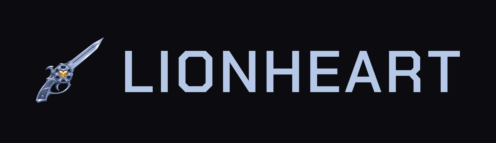

A native PC port of the original PlayStation Final Fantasy VIII, built by static recompilation.

> **Work in progress. No full playthrough has been verified yet.** Save often to your memory card and report
> bugs.

You need your own discs. Lionheart contains no game code or data: it reads the game from your discs every time
it runs.

- **Supported:** the USA release (SLUS-00892, SLUS-00908, SLUS-00909, SLUS-00910).
- **Disc images:** single-track `.cue`/`.bin` (MODE1/2352 or MODE2/2352), or a raw 2352-byte `.bin`.
- **Not supported:** 2048-byte ISO, CHD and PBP.

## Features

- Vulkan rendering at up to 8× internal resolution, with PGXP precise geometry, MSAA and CRT presets.
- A setup screen and an in-game menu for discs, memory cards, video and controls.
- Save states, screenshots, and controller hotkeys for both.
- Optional HD movies from your own files.
- Opt-in, casual RetroAchievements with search, progress and unlock notifications (Guide + ✕ / F10).

Rendering defaults to the original software output.

## Build

There are no prebuilt releases yet.

### Linux

You need:
- a C99/C++ compiler, CMake 3.16+, Python 3.13+ and pkg-config;
- development files for SDL2 2.0.14+, libcurl 8+, D-Bus, Vulkan, zlib and FFmpeg (libavformat, libavcodec, libavutil,
  libswscale);
- for Vulkan rendering, your GPU's Vulkan driver.

`glslc` is optional, since prebuilt shader headers are included.

```sh
cmake -S . -B build
cmake --build build
```

The player is `build/lionheart`. To install it with its desktop entry and icons:

```sh
cmake --install build --prefix "$HOME/.local"
```

### Windows (cross-built on Linux)

You need the Linux tools above, plus `make`, `tar` and `xz`. The script downloads the dependency archives pinned
in [`tools/windows-deps.json`](tools/windows-deps.json), checks their sizes and SHA-256 sums, and builds FFmpeg
and the player:

```sh
python3 tools/build_windows.py
```

`build/windows/dist-windows/` then holds `Lionheart.exe`, its DLLs and the licence notices. Keep that folder
together. It has not yet been tested on a physical Windows machine.

## First run

Start Lionheart with no arguments. The setup screen asks for your discs and a memory card; you can create a new
card or import a copy of an existing one. Then press **Play**.

During the game, **Esc** or the controller's **Guide** button opens the menu. A renderer change made there applies
at the next launch.

You can also pass discs on the command line. Repeat `--disc` for each disc; Lionheart detects which disc is which:

```sh
./build/lionheart --disc "/path/to/disc1.cue"
```

On Windows: `Lionheart.exe --disc "C:\Games\FF8\disc1.cue"`.

## Controls

Controllers map to the original pad. Keyboard and hotkeys:

| Action | Keyboard | Controller |
| --- | --- | --- |
| D-pad | Arrow keys or WASD | |
| Cross, Circle, Square, Triangle | X, Z, C, V | |
| L1, R1, L2, R2 | Q, E, 1, 3 | |
| Start, Select | Enter, Backspace | |
| Menu | Esc | Guide |
| Save / load state | F5 / F7 | Guide+R1 / Guide+L1 |
| Previous / next state slot | F6 / F8 | Guide+Left / Guide+Right |
| Change disc | F1–F4 | Guide+Select |
| Fast forward (hold) | Tab | Guide+R2 |
| Screenshot | F12 | Guide+Square |
| CRT preset / fullscreen | F9 / F11 | Guide+Triangle / Guide+Start |

## Configuration and files

Settings changed in the menu are saved to `lionheart.ini`. Lionheart looks for it in this order:
1. next to the executable;
2. `~/.config/lionheart/lionheart.ini` on Linux (it respects `$XDG_CONFIG_HOME`);
3. `%APPDATA%\Lionheart\lionheart.ini` on Windows.

`--config PATH` selects a specific file. Paths inside the file are relative to it. Example:

```ini
disc1=disc1.cue
renderer=vulkan
internal-scale=4
pgxp=perspective
crt=tv
```

| Key | Values (default first) |
| --- | --- |
| `disc1` … `disc4` | Disc image paths |
| `card1`, `card2` | Memory card paths; card 1 defaults to `cards/card1.mcr` |
| `verify-discs` | `quick`, `full` |
| `renderer` | `soft`, `vulkan` |
| `internal-scale` | `1`–`8` |
| `pgxp` | `off`, `vertex`, `perspective` |
| `true-color` | `0`, `1` |
| `msaa` | `1`, `2`, `4`, `8` |
| `crt` | `off`, `pvm`, `tv`, `arcade` (Vulkan only) |
| `scale-mode` | `aspect`, `integer`, `stretch`, `aspect-crop` |
| `filter` | `nearest`, `linear` |
| `fullscreen` | `0`, `1` |
| `osd` | `1`, `0` |
| `ra` | `0`, `1` (accept the warning and sign in from the menu) |
| `ra-notify` | `1`, `0` (unlock notifications) |
| `pad` | `digital`, `dualshock` |
| `rumble` | `1`, `0` |
| `pad-hotkey` | `guide`, `off` |
| `movies` | Folder with your HD movies, named like `disc00_00h.avi` |
| `screenshot-dir`, `savestate-dir` | Output folder overrides |
| `savestate-verify-disc` | `quick`, `full` |
| `savestate-cards` | `live` (loading a state keeps your current card files), `snapshot` |

**Where your data lives:**
- **Linux:** `~/.local/share/lionheart` (it respects `$XDG_DATA_HOME`).
- **Windows:** `%APPDATA%\Lionheart`.

That folder holds the memory cards, save states (`states/`) and the log (`logs/lionheart.log`, plus the four
previous sessions). Screenshots go to `Pictures/Lionheart`.

RetroAchievements stores only your username and login token in `ra/credentials` (0600 on Linux), and badges in
`ra/badges/`. Sign out removes the credentials. Passwords are never saved. This is an unapproved, casual-only
client; save states and fast-forward remain available.

For a portable setup, put an empty file named `portable` next to the executable. Config and data then stay beside
it. RetroAchievements credentials on Windows always stay in `%APPDATA%\Lionheart`.

Save states only load in the build that made them. Rely on in-game memory card saves.

## Reporting bugs

Open an issue on the [issue tracker](https://github.com/rash-pro/lionheart/issues). Include:
- `lionheart.log`;
- the disc number;
- where you were in the game;
- the steps that lead to the problem.

## Contributing

The repository contains everything: the recompiler, the runtime, the host and the tests. Contributors generate the
recompiled build from their own discs with one command:

```sh
python tools/setup.py --disc1 /path/to/disc1.cue
```

See [CONTRIBUTING.md](CONTRIBUTING.md) for setup, tests and the rules, [ARCHITECTURE.md](ARCHITECTURE.md) for how
it fits together, and [docs/debugging.md](docs/debugging.md) for tracking down recompilation bugs.

## Roadmap

- Smoother battles: fewer frame-time spikes, and interpolated 60 fps presentation.
- Packaged Linux and Windows releases.

## Legal

Lionheart is not affiliated with or endorsed by Square Enix. Final Fantasy is a trademark of Square Enix. No game
code or data is distributed; you must own the discs you use. Lionheart's code is MIT-licensed; see
[LICENSE](LICENSE) and [THIRD_PARTY_NOTICES.md](THIRD_PARTY_NOTICES.md).
