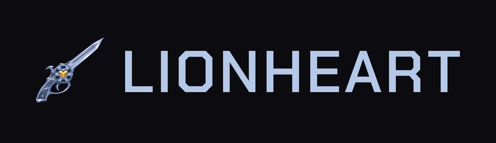
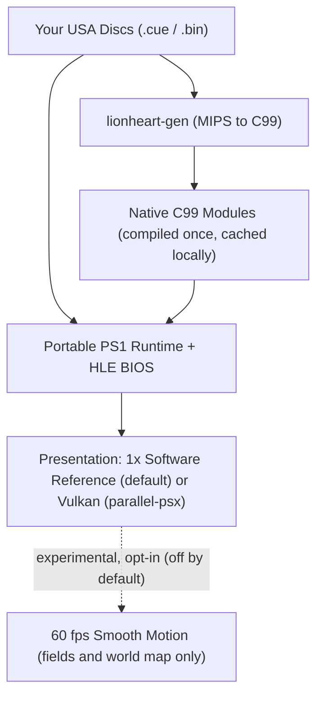

<p align="center">
  
</p>

<p align="center">
  <a href="https://github.com/rash-pro/lionheart/actions/workflows/ci.yml"></a>
  <a href="https://github.com/rash-pro/lionheart/releases"></a>
  <a href="LICENSE"></a>
  
</p>

Lionheart is a native PC port of the original PlayStation *Final Fantasy VIII*, built by clean-room static recompilation into C99. It ships **zero game code, game data, or PlayStation BIOS**: you supply your own retail discs, and Lionheart reads assets from them and compiles native code locally on your machine.

> [!WARNING]
> **Work in progress. No full playthrough has been verified yet.** Save often to your memory card and report bugs on the [issue tracker](https://github.com/rash-pro/lionheart/issues).

### Disc requirements

You need your own discs. Lionheart contains no game code or data: it reads the game from your discs every time it runs.

- **Supported:** the USA release (`SLUS-00892`, `SLUS-00908`, `SLUS-00909`, `SLUS-00910`).
- **Disc images:** single-track `.cue`/`.bin` (`MODE1/2352` or `MODE2/2352`), or a raw 2352-byte `.bin`.
- **Not supported:** 2048-byte ISO, CHD, and PBP.

---

## Why Lionheart?

- **No retail BIOS required:** Ships with a built-in HLE BIOS — just bring your own USA discs.
- **One-time local native compilation (with loading screen):** On first launch (or after adding discs), Lionheart compiles C99 native modules for your PC ahead of time behind a progress screen (using Clang, GCC, or an auto-installed Zig C compiler) so compilation never competes with gameplay. Closing saves progress and resumes on the next launch, and an optional **Play anyway** button lets you jump in immediately while the rest finishes in the background. Compiled modules are cached locally for instant subsequent launches.
- **Modern Vulkan presentation (`parallel-psx`) + deterministic software reference:** Defaults to the original 1× software reference renderer, with optional Vulkan rendering up to 8× internal resolution, PGXP (`vertex` and `perspective` precise geometry), MSAA, true color, and CRT presets (`pvm`, `tv`, `arcade`).
- **Experimental 60 fps Smooth Motion (opt-in, off by default):** Presentation-only frame interpolation using GTE vertex-identity tracking and polar-decomposition motion estimation that preserves PGXP and exact guest timing. Currently **experimental**, **off by default**, covers **fields and the world map only** (not battles yet), and **may show visual artifacts in some scenes** (`--smooth-motion`, `smooth-motion=1`, or **Video → Smooth motion**).
- **Quality of life & preservation:**
  - ImGui setup screen and in-game menu for discs, memory cards, video, and controls.
  - Save states, screenshots, and controller hotkeys for both.
  - Optional HD movies from your own files.
  - Opt-in, casual-only RetroAchievements with search, progress, and unlock notifications (`Guide + ✕` / `F10`).
  - Pure **MIT** license.

---

## How it works



1. **Clean-room static recompilation:** `lionheart-gen` verifies your discs against clean-room catalog metadata, decodes the MIPS executable and overlays, and emits portable C99 translation units locally on your machine.
2. **One-time pre-game build with resumable cache:** On first run, a loading screen builds the native modules for your discs before gameplay starts so compilers never contend with frame pacing (with an optional **Play anyway** button to start immediately while remaining modules finish and hot-swap in the background). Later launches reuse the cache immediately.
3. **Strict separation of guest & presentation:** The portable PS1 runtime and HLE BIOS run with exact guest timing; Vulkan scaling, PGXP, CRT shaders, and the optional experimental Smooth Motion presenter never alter guest state or software reference output.

See [ARCHITECTURE.md](ARCHITECTURE.md) and [docs/native-modules.md](docs/native-modules.md) for the full design.

---

## Install

Download packages from the [releases page](https://github.com/rash-pro/lionheart/releases), with a `SHA256SUMS` file to check them against (`sha256sum -c SHA256SUMS --ignore-missing`). They are not code-signed. Neither contains game code or a compiler.

### Linux

Download `Lionheart-VERSION-x86_64.AppImage` from the releases page. Run `chmod +x Lionheart-*-x86_64.AppImage`, then `./Lionheart-*-x86_64.AppImage`. Use `./Lionheart-*-x86_64.AppImage --version` to check its version.

It runs on x86-64 distributions with glibc 2.35 or later (Ubuntu 22.04, Debian 12, Fedora 36 and newer). It brings SDL2, FFmpeg, libcurl and zlib, and uses these from the system: the C and C++ runtimes, OpenSSL 3, D-Bus, your audio and display libraries, and your GPU's Vulkan driver. The launcher bundles libfuse, so no FUSE library has to be installed; it does use the `fusermount3` or `fusermount` program, which desktop installations have (package `fuse3`). Without it, or where mounting is not allowed, run it with `--appimage-extract-and-run`.

The AppImage installs nothing. To get a menu entry, use an AppImage integration tool such as AppImageLauncher or Gear Lever, which reads the entry and icon inside it.

### Windows

Unzip `Lionheart-VERSION-windows-x86_64.zip` and run `Lionheart\Lionheart.exe`. Keep the folder together. As the program is not signed, SmartScreen may ask first: choose **More info**, then **Run anyway**.

> [!NOTE]
> **Windows testers welcome:** Windows builds are cross-compiled on Linux and have not yet been tested on a physical Windows machine (including compiling the game's native code on Windows). Early reports from real Windows hardware — whether things work or break — are very welcome on the [issue tracker](https://github.com/rash-pro/lionheart/issues).

### Upgrade and roll back

Your discs, memory cards, settings and save states live in your data folder (see [Configuration and files](#configuration-and-files)), never in the package, so a new or older version finds them as they were.

- **Linux:** replace the AppImage with the new file. To roll back, run the older one.
- **Windows:** unzip the new zip where you unzipped the old one, so that its `Lionheart` folder lands on yours, and replace the files when asked. A portable folder keeps its data: the zip holds only program files, none named like your data. To roll back, do the same with the older zip.

Save states load only in the build that made them, as before; in-game memory card saves always carry over. The native code Lionheart compiled is reused when the new version would compile the same code, and otherwise built again on the loading screen before play starts, as on the first run; the old copy is removed once no Lionheart uses it.

---

## Build

### Linux

You need:

- a C99/C++ compiler, CMake 3.21+ and pkg-config;
- development files for SDL2 2.0.14+, libcurl 8+, D-Bus, Vulkan, zlib and FFmpeg (`libavformat`, `libavcodec`, `libavutil`, `libswscale`);
- for Vulkan rendering, your GPU's Vulkan driver.

`glslc` is optional, since prebuilt shader headers are included.

```sh
cmake -S . -B build
cmake --build build
```

The player is `build/lionheart`. To install it with its desktop entry and icons:

```sh
cmake --install build --prefix "$HOME/.local"
```

### Windows (cross-built on Linux)

You need the Linux tools above, plus `make`, `tar` and `xz`. The script downloads the dependency archives pinned in [`tools/windows-deps.json`](tools/windows-deps.json), checks their sizes and SHA-256 sums, and builds FFmpeg and the player:

```sh
cmake -P tools/build_windows.cmake
```

`build/windows/dist-windows/` then holds `Lionheart.exe`, its DLLs and the licence notices. Keep that folder together. It has not yet been tested on a physical Windows machine, and neither has compiling the game's native code there: reports from Windows are welcome on the [issue tracker](https://github.com/rash-pro/lionheart/issues).

Set `-DDEPS=/path/to/dependencies`, `-DBUILD=/path/to/build` or `-DJOBS=4` before `-P` to override the defaults. `-DOFFLINE=ON` requires verified cached inputs and disables downloads. An installed dependency prefix has a receipt tied to the dependency lock, build recipe and installed file bytes. If an older cache has no receipt, remove its `install-ucrt` folder and rebuild from its verified cached sources.

### Release packages

The AppImage and the Windows zip are built from a version tag by [`.github/workflows/release.yml`](.github/workflows/release.yml). [docs/releasing.md](docs/releasing.md) says how to cut a release and how to rebuild either package byte for byte.

---

## First run

Start Lionheart with no arguments. The setup screen asks for your discs and a memory card; you can create a new card or import a copy of an existing one. Then press **Play**.

Lionheart compiles the game from your discs into native code for your PC on a loading screen before play starts (all four discs take roughly 20 to 45 minutes on a 16-thread PC, longer on a smaller one; closing saves progress and resumes next launch, or you can click **Play anyway** to start immediately while the rest finishes in the background). The result takes about 600 MB and later launches start at once. On Linux it uses Clang or GCC when one is installed and works, and asks nothing more. Otherwise the third setup step installs the Zig C compiler from ziglang.org, a download made once: 55 MB on Linux, 96 MB on Windows. You can skip the step and install the compiler later from the menu; the game runs without it, more slowly. On a PC without a connection, download Zig 0.17.1 for your system (`zig-x86_64-linux-0.17.1.tar.xz` or `zig-x86_64-windows-0.17.1.zip`) from [Zig's download page](https://ziglang.org/download/) and choose it in that step.

During the game, **Esc** or the controller's **Guide** button opens the menu. A renderer change made there applies at the next launch.

On Linux, an installed Lionheart also appears under **Open With** for cue sheets. Opening one keeps the discs you already set up.

You can also pass discs on the command line. Repeat `--disc` for each disc; Lionheart detects which disc is which:

```sh
./build/lionheart --disc "/path/to/disc1.cue"
```

On Windows: `Lionheart.exe --disc "C:\Games\FF8\disc1.cue"`.

Run `./build/lionheart --version` (Windows: `Lionheart.exe --version`) and include the output in bug reports. It prints the version and, for a build made from a git checkout, its commit, without starting the player.

---

## Controls

Controllers map to the original pad. Keyboard and hotkeys:

| Action | Keyboard | Controller |
| --- | --- | --- |
| D-pad | Arrow keys or WASD | |
| Cross, Circle, Square, Triangle | X, Z, C, V | |
| L1, R1, L2, R2 | Q, E, 1, 3 | |
| Start, Select | Enter, Backspace | |
| Menu | Esc | Guide |
| Save / load state | F5 / F7 | Guide+R1 / Guide+L1 |
| Previous / next state slot | F6 / F8 | Guide+Left / Guide+Right |
| Change disc | F1–F4 | Guide+Select |
| Fast forward (hold) | Tab | Guide+R2 |
| 3× speed (toggle) | T | Guide+L2 |
| RetroAchievements | F10 | Guide+Cross |
| Screenshot | F12 | Guide+Square |
| CRT preset / fullscreen | F9 / F11 | Guide+Triangle / Guide+Start |

---

## Configuration and files

Settings changed in the menu are saved to `lionheart.ini`. Lionheart looks for it in this order:

1. next to the executable;
2. `~/.config/lionheart/lionheart.ini` on Linux (it respects `$XDG_CONFIG_HOME`);
3. `%APPDATA%\Lionheart\lionheart.ini` on Windows.

`--config PATH` selects a specific file. Paths inside the file are relative to it. Example:

```ini
disc1=disc1.cue
renderer=vulkan
internal-scale=4
pgxp=perspective
crt=tv
```

| Key | Values (default first) |
| --- | --- |
| `disc1` … `disc4` | Disc image paths |
| `card1`, `card2` | Memory card paths; card 1 defaults to `cards/card1.mcr` |
| `verify-discs` | `quick`, `full` |
| `renderer` | `soft`, `vulkan` |
| `internal-scale` | `1`–`8` |
| `pgxp` | `off`, `vertex`, `perspective` |
| `true-color` | `0`, `1` |
| `msaa` | `1`, `2`, `4`, `8` |
| `crt` | `off`, `pvm`, `tv`, `arcade` (Vulkan only) |
| `smooth-motion` | `0`, `1` (experimental, opt-in; fields and world map only, not battles yet; may show visual artifacts in some scenes) |
| `speed-boost` | `0`, `1` (3× capped speed toggle; `T` or `Guide+L2`) |
| `no-encounters` | `0`, `1` (disables random battles on fields and world map; **permanently disables RetroAchievements**) |
| `battle-assist` | `0`, `1` (full HP, full ATB, and Limit Breaks ready in battle; **permanently disables RetroAchievements**) |
| `hd-font` | `off`, `builtin` (OFL Barlow), `custom` (Vulkan only) |
| `hd-font-path` | Custom `.ttf`/`.otf` font or `.png` atlas for `hd-font=custom` |
| `hd-textures` | `0`, `1` (Vulkan VRAM texture replacement from `textures-dir`) |
| `textures-dir`, `dump-textures` | External HD texture pack folder / optional VRAM texture dump folder |
| `hd-models`, `models-dir` | `0`, `1` and folder with external glTF (`.glb`) HD model packs (see [docs/enhancements.md](docs/enhancements.md)) |
| `scale-mode` | `aspect`, `integer`, `stretch`, `aspect-crop` |
| `filter` | `nearest`, `linear` |
| `fullscreen` | `0`, `1` |
| `osd` | `1`, `0` |
| `ra` | `0`, `1` (accept the warning and sign in from the menu) |
| `ra-notify` | `1`, `0` (unlock notifications) |
| `pad` | `digital`, `dualshock` |
| `rumble` | `1`, `0` |
| `pad-hotkey` | `guide`, `off` |
| `movies` | Folder with your HD movies, named like `disc00_00h.avi` |
| `screenshot-dir`, `savestate-dir` | Output folder overrides |
| `savestate-verify-disc` | `quick`, `full` |
| `savestate-cards` | `live` (loading a state keeps your current card files), `snapshot` |

**Where your data lives:**

- **Linux:** `~/.local/share/lionheart` (it respects `$XDG_DATA_HOME`).
- **Windows:** `%APPDATA%\Lionheart`.

That folder holds the memory cards, save states (`states/`) and the log (`logs/lionheart.log`, plus the four previous sessions). Screenshots go to `Pictures/Lionheart`.

RetroAchievements stores only your username and login token in `ra/credentials` (`0600` on Linux), and badges in `ra/badges/`. Sign out removes the credentials. Passwords are never saved. This is an unapproved, casual-only client; save states and fast-forward remain available.

For a portable setup, put an empty file named `portable` next to the executable. Config and data then stay beside it. RetroAchievements credentials on Windows always stay in `%APPDATA%\Lionheart`.

Save states only load in the build that made them. Rely on in-game memory card saves.

---

## Reporting bugs

Open an issue on the [issue tracker](https://github.com/rash-pro/lionheart/issues). Include:

- `lionheart.log`;
- the output of `--version`;
- the disc number;
- where you were in the game;
- the steps that lead to the problem.

## Contributing

The repository contains everything: the recompiler, the runtime, the host and the tests. Contributors generate the recompiled build from their own discs with one command:

```sh
cmake -P tools/setup.cmake -- --disc1 /path/to/disc1.cue
```

See [CONTRIBUTING.md](CONTRIBUTING.md) for setup, tests and the rules, [ARCHITECTURE.md](ARCHITECTURE.md) for how it fits together, [docs/native-modules.md](docs/native-modules.md) for background module compilation, and [docs/debugging.md](docs/debugging.md) for tracking down recompilation bugs.

## Roadmap

- Smoother battles: fewer frame-time spikes, and extending experimental smooth motion (currently opt-in and available for fields and the world map only) to battle geometry and battle magic effects.

## Legal

Lionheart is not affiliated with or endorsed by Square Enix. Final Fantasy is a trademark of Square Enix. No game code, game data, or PlayStation BIOS is distributed; you must own the discs you use. Lionheart's code is MIT-licensed; see [LICENSE](LICENSE) and [THIRD_PARTY_NOTICES.md](THIRD_PARTY_NOTICES.md).
